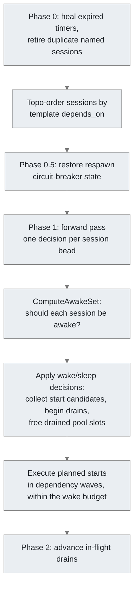

> Last verified against code: 2026-09-19

This document explains how the controller keeps running sessions in line
with what the city wants: how the tick is laid out, what the session
reconciler decides for each session bead, and how starts and stops are
carried out. It is written for contributors who are about to read or change
`cmd/gc/session_reconciler.go` for the first time.

**Who this is for.** You know what a session and a bead are (see
[Session](./session.md) and [Bead Store](./beads.md)) and roughly what the
controller does (see [Controller](./controller.md)). You now need to work
out why a session did or did not start, stop, or restart, or where a
change to that behaviour belongs.

**What this is not.** It is not a list of every branch. The reconciler is
thousands of lines, and most of that is edge-case handling with a test
named after the incident that caused it. This document gives you the
structure those branches fit into. For the step-by-step incident workflow,
see [Reconciler Debugging](../contributors/reconciler-debugging.md).

## The One-Sentence Model

On every tick, the controller computes a **desired state** (which session
names should exist, and with which template parameters), loads the
**session beads** (the durable record of every session), probes the
**runtime** (which of those sessions are actually running), and then, for
each session bead, takes the one action that moves it closer to desired:
start it, leave it alone, drain it, restart it, or close its bead.

Three rules follow from that model and shape the rest of the code:

1. **Beads are the source of truth, not memory.** The controller keeps
   only caches and in-flight bookkeeping in memory (drains, idle probes,
   crash windows). All of that can be lost on a controller restart, and
   the next tick rebuilds the same decisions from beads and runtime
   probes.
2. **Every tick is idempotent.** A healthy session whose config hash
   matches is skipped, and running the same tick twice against the same
   state does nothing the second time. If a change breaks this, it is a
   bug.
3. **Wake reasons are recomputed on every tick and never stored.** A
   session is awake because a reason exists right now: config, assigned
   work, an attached terminal, a pin, a pending interaction, a ready
   wait. When the reason goes away, the session becomes a drain
   candidate.

## Where Reconciliation Sits in a Tick

The controller runs one `CityRuntime` per city
(`cmd/gc/city_runtime.go`). Its `run()` loop fires `tick()` on any of
these:

- the patrol ticker (`[daemon] patrol_interval`, default 30s)
- a **poke** (`pokeCh`), which follow-up requests use to get another
  tick right away, for example after an async start finishes or a
  deferred drain is ready to advance
- a config reload request, a nudge wake, a control-dispatcher event, or
  a convergence request

Every tick runs inside `safeTick`, which recovers panics, so one bad tick
cannot kill the controller.

`tick()` does much more than session reconciliation. The session-relevant
part runs in this order (trace phase names are in parentheses; they are
what `gc trace` shows):

```text
tick()
 ├─ config reload, if dirty or requested
 ├─ dispatch_orders                     order gates run before the slow session work
 ├─ load_session_snapshot.initial
 ├─ cleanup_dead_runtime_session_corpses
 ├─ reap_runtimes_bound_to_closed_beads
 ├─ sweep_process_table_orphans
 ├─ reap_stale_session_beads
 ├─ finalize_drain_ack_stop_pending     finish stops that agents acked last tick
 ├─ load_demand_snapshot                build desired state: config + scale_check + assigned work
 ├─ refresh_desired_state / sync_beads_and_update_index
 │                                      create or adopt session beads for desired names
 └─ bead_reconcile_tick                 beadReconcileTick()
     ├─ sweep_undesired_pool_sessions   skipped on the boot tick
     ├─ prepare_wait_wake_state         which durable waits are ready
     ├─ filter_assigned_work_for_wake
     ├─ reconcile_sessions              reconcileSessionBeadsTracedWithNamedDemand()
     ├─ dispatch_wait_nudges
     └─ nudge_dispatch_tick, idle-claim recovery, ...
```

The rest of this document is about the `reconcile_sessions` step. The
steps before it matter for one reason: they decide what the reconciler
sees. If a session is missing from desired state, the reconciler treats
it as orphaned or suspended. That is the single most common reason for a
surprising drain.

## Inputs

The reconciler entry point is `reconcileSessionBeadsTracedWithNamedDemand`
in `cmd/gc/session_reconciler.go`. The other `reconcileSessionBeads*`
functions are compatibility wrappers for tests and `cmd_start.go`; they
build the same inputs from raw beads and call through. The inputs that
matter most:

| Input | Built by | Meaning |
|---|---|---|
| `rows` / `snapshot` | `loadSessionBeadSnapshot` → `OpenForReconcile()` | Every open session bead, projected once into a typed `session.Info` plus its circuit-breaker state. |
| `desiredState` | `buildDesiredStateWithSessionBeads` (`cmd/gc/build_desired_state.go`) | Session name → `TemplateParams`. The sessions that should exist this tick. |
| `configuredNames` | `configuredSessionNamesWithSnapshot` | Every configured session name, **including suspended ones**. Lets the reconciler tell "removed from config" (orphan) apart from "in config but not runnable" (suspended). |
| `poolDesired` | scale_check counts | Template → how many pool sessions the demand calls for. |
| `assignedWorkBeads` | desired-state build, filtered for wake | Work beads with an assignee. They drive the `work` wake reason and the assigned-work guards on stop paths. |
| `readyWaitSet` | `prepareWaitWakeStateWithSnapshot` | Session bead IDs whose durable `gc wait` is ready. |
| `namedSessionDemand` / `namedRoutedDemand` | desired-state build | Direct and routed demand for configured named sessions. |
| `storeQueryPartial` | desired-state build | True when some store read failed. Destructive paths (rollbacks, closes) are skipped while it is true, so a flaky store cannot make live sessions look orphaned. |
| `dt` (`drainTracker`) | `CityRuntime.sessionDrains` | In-memory drain, idle-probe, and deferral state. Lives across ticks, is lost on restart. |
| `dops` (`drainOps`) | `CityRuntime.dops` | Reads and writes of runtime drain metadata such as `GC_DRAIN_ACK`. |
| `sp` (`runtime.Provider`) | `CityRuntime.sp` | Liveness probes, `Start`, `Stop`, peek, and metadata. |

How desired state is built (templates, pools, scale_check, named-session
modes, suspension) is its own subject. For this document it is enough to
know that `buildDesiredState` is the only place that decides which
sessions should exist, and that it also creates missing session beads as a
side effect, so every desired name has a bead by the time the reconciler
runs.

## The Reconciler, Phase by Phase

Inside `reconcileSessionBeadsTracedWithNamedDemand`, every phase records a
`session_reconcile.*` trace entry. The shape is:



### Phase 0: fold heals before building the snapshot

Before anything else, the reconciler fixes up the row feed:

- **0a, heal expired timers.** Held and quarantine timers that have
  expired are cleared (`healExpiredTimersInfo`).
- **0b, retire duplicate configured named sessions.** If two beads claim
  the same configured named identity, the losers are retired.

These are *folded into* the rows before the per-tick snapshot is built,
so every later read sees the healed values without reading the store
again.

The rows are then **topologically ordered** by template `depends_on`
(`topoOrderRows`). That order is load-bearing. Starts respect it, and the
awake computation resolves duplicate session names last-write-wins, so
iterating a Go map instead would make decisions non-deterministic.

### The tick snapshot (`reconcileTick`)

The reconciler keeps one typed snapshot for the tick, `infoByID` (bead ID
→ `session.Info`). Each session-bead write happens twice: once to the
store, through the `session.Store` front door (`sessFront`), and once to
the snapshot, so later phases in the same tick see the result.

The snapshot write must go through `reconcileTick` in
`cmd/gc/reconcile_tick.go` (`apply`, `applyResult`, `markClosed`, `set`),
or through `sessFront.ApplyPatchInfo`, which writes and returns the folded
`Info` in one call. `TestReconcileTickFoldFrontDoor` fails the build if
you assign `infoByID[...] =` directly. The rule exists because a
forgotten fold compiles cleanly and then makes a later scan (pool
min-floor counts, the awake set, drains) decide on stale state.

**If you add a write in the forward pass, fold it onto the snapshot
before the next read.** Many comments in the forward pass are
justifications of exactly this: why a given `info` read is still coherent
at that point.

### Phase 1: the forward pass

The forward pass visits each session bead in topo order and handles the
states that do not depend on the cross-session awake decision. For each
session it looks up `tp, desired := desiredState[name]` and then runs the
checks below **in order**. Most branches end in `continue`, which means
this session is done for the tick.

1. **Drain-ack stop pending.** If an earlier tick queued a stop after the
   agent acked a drain, finish or keep waiting on it
   (`reconcileDrainAckStopPending`).
2. **Unknown state.** If the bead's `state` metadata is a value this
   binary does not recognise, skip the session and emit a throttled
   `session.unknown_state` diagnostic. This is what lets an older binary
   run safely against beads written by a newer one.
3. **Not desired: orphaned or suspended.** This branch runs before any
   health or crash check, because a session leaving the desired set is
   not a crash. Depending on the facts it can:
   - roll back a stale pending create whose lease has expired, so the
     alias is released (at most `maxRollbacksPerTick` = 5 per tick, since
     each rollback costs several store writes)
   - keep a configured named session that is only briefly absent
     (`preserveNamed`), with a multi-tick confirmation window before a
     suspend drain (`bumpSuspendDeferral`, #3630)
   - close failed-create beads
   - heal advisory state from runtime liveness and then drain or close
     the session
4. **Liveness and zombies.** For desired sessions, probe `running` (the
   runtime session exists) and `alive` (the expected process is inside
   it). `running && !alive` is a **zombie**: the reconciler captures
   scrollback for forensics and may record a provider terminal error.
5. **Pending-create rollback, desired side.** A bead marked
   `pending_create_claim` with no live runtime and no active lease is
   stuck. It is rolled back so a fresh slot can take the alias.
6. **Drain ack.** The agent said it is done (`gc runtime drain-ack`, which
   sets `GC_DRAIN_ACK`). The reconciler honours the ack even if the
   process already exited, stops the session, and finalizes it. Pool
   sessions free their slot; named sessions keep their bead.
7. **Progress stall.** Opt-in through `[session] progress_stall_timeout`.
   An alive session with no activity past the threshold is marked for a
   restart, which the next step performs.
8. **Restart requested.** The agent or an operator asked for a fresh
   session (`gc runtime request-restart`, `gc handoff`). This check runs
   before the crash heuristics, so an explicit reset is not mistaken for
   a crash loop.
9. **Rate limit, heal, stability, churn.** Detect a provider rate limit
   from the pane, heal advisory `state` from liveness, then run the crash
   accounting:
   - `checkStability` flags a rapid crash shortly after start.
   - `checkChurn` flags a session that lives past the stability window
     but dies before it has done useful work (context-exhaustion
     spirals).
   - Stable, productive sessions get their wake-failure and churn
     counters cleared.
10. **Config drift.** For an alive session, compare
    `started_config_hash` (what the session actually started with) with
    the hash of the current config. See [Config drift](#config-drift)
    below. An asleep named session gets a lighter repair so it wakes on
    the new config.
11. **Max session age.** Opt-in through the agent's `max_session_age`.
    Restart sessions older than the threshold. This targets credentials
    cached at start that later expire. `sessionpkg.DecideMaxSessionAge`
    decides; the reconciler gathers facts and carries out the result.
12. **Idle timeout.** Stop sessions idle longer than `idle_timeout`.
    `sessionpkg.DecideIdleTimeout` decides. A per-bead streak counter
    force-stops a session that keeps deferring on the same assigned bead
    (`assigned_work_exhausted`).

A session that reaches the end of the forward pass is appended to
`wakeTargets` with its current `Info` and liveness.

Steps 11 and 12 follow a pattern you will see again: **a pure decider in
`internal/session/` and a fact-gathering executor in `cmd/gc/`.** The
decider returns an outcome from a fixed order of checks: blocker, then
pending interaction, then assigned work, then stop. The reconciler
probes the runtime and the store, calls the decider, and performs what it
returns. When you add a new timed policy, follow this split; it keeps
the decision testable without a runtime.

### ComputeAwakeSet: should each session be awake?

After the forward pass, the reconciler builds an `AwakeInput` from the
snapshot and calls `ComputeAwakeSet` (`cmd/gc/compute_awake_set.go`). It
is a **pure function**: all I/O has already happened. Its algorithm, from
its own doc comment:

1. Build the desired set from config and demand signals.
2. Any session in the desired set should wake.
3. Attached, pending-interaction, and ready-wait sessions wake even if
   they are not desired.
4. Apply idle-sleep suppression.
5. Apply hold and quarantine suppression, which overrides everything.

The output, one `AwakeDecision` per session, carries `ShouldWake`, a
human-readable `Reason`, whether assigned work anchored the decision, and
`RequiresFreshCycle` for a session that was reassigned to a different
bead.

The wake reasons (`WakeReason` in `cmd/gc/session_types.go`) are `config`,
`create`, `session`, `keep-warm`, `attached`, `wait`, `work`, `pending`,
and `pin`. **They are never stored.** If you want to know why a session
is awake, read the trace; do not look for a field on the bead.

The reconciler then resolves the workspace-level `session_sleep` policies,
which need the config and the provider and therefore do not fit in the
pure function, and selects sessions for async idle probes.

`ComputeAwakeSet` does not enforce dependency order. Start execution
handles that.

### Applying wake/sleep decisions

For each wake target, the four combinations of `shouldWake` and `alive`
give the next action:

| `shouldWake` | `alive` | Action |
|---|---|---|
| yes | no | **Start candidate**, unless the respawn circuit breaker is open or the provider-health gate is red. A blocked session does not use up the wake budget. |
| yes | yes | **Keep running.** Cancel any cancellable drain (the session came back into the desired set). If the session was reassigned to a new bead and uses `wake_mode=fresh`, route it through the restart handoff. Record `currently_processing_bead_id`. |
| no | yes | **Begin a drain.** A heartbeat hold (`held_until` in the future, no `sleep_intent`) is a keep-alive and is left running. |
| no | no | **Nothing to run.** A pool session whose runtime exited and whose bead is in a terminal sleep state has its bead closed, so a fresh worker can take the slot. This happens only after a live check confirms the session holds no open assigned work in the city store or any rig store. |

One exception runs before the table. A session held by a heartbeat whose
runtime has **died** while it still holds assigned work gets respawn
eligibility back (#3994). A hold defers timers; it does not block crash
recovery.

### Executing planned starts

`executePlannedStartsTraced` (`cmd/gc/session_lifecycle_parallel.go`)
takes the start candidates and:

1. **Groups them into dependency waves** from template `depends_on`. A
   wave starts only when the templates it depends on are alive;
   otherwise its candidates log `blocked_on_dependencies`.
2. **Spends the wake budget.** At most `[daemon] max_wakes_per_tick`
   (default 5) starts per tick. Within a wave, candidates are sorted by
   least-recently-woken, so the same sessions at the back of the topo
   order are not deferred every tick. Deferred candidates log
   `deferred_by_wake_budget` and are retried on the next tick.
3. **Prepares each start**
   (`prepareStartCandidateForCity` → `preWakeCommit`), which bumps
   `generation`, mints a new `instance_token`, and writes the pre-wake
   metadata **before** `Start` is called.
4. **Runs the starts** in bounded parallel. In the controller they run
   asynchronously (`withAsyncStartExecution`), and completion requests a
   follow-up tick through the poke channel.

The wake budget is why a city with many sessions takes several patrol
intervals to come fully up: roughly `ceil(N / max_wakes_per_tick) *
patrol_interval`.

`generation` and `instance_token` are the fence that makes asynchronous
stops safe. A drain records the generation it started under. A stop
checks the token first (`verifiedStop`), so a stale drain cannot kill a
session that has since been woken again.

### Phase 2: advancing drains

A drain is not a stop. `beginSessionDrainInfo` records a `drainState` in
the `drainTracker` (reason, deadline, generation) and returns.
`advanceSessionDrainsWithSessionsTraced` (`cmd/gc/session_wake.go`) then
moves every in-flight drain forward, once per tick:

1. **Stale generation?** The session was woken again, so the drain is
   cancelled.
2. **Process already exited?** The drain is complete; write the
   drained/asleep metadata.
3. **Wake reason came back?** Cancellable drains (idle, no wake reason)
   are cancelled. Orphan, suspend, config-drift, and `execution-stalled`
   drains are not.
4. **Survived a full tick?** Set `GC_DRAIN_ACK` on the session. Waiting
   one tick means a single transient store failure, which can make a
   live session look orphaned for one tick, never interrupts a working
   agent. The Phase 1 drain-ack check stops the session cleanly on a
   later tick.
5. **Past the deadline?** Force-stop through `verifiedStop`, re-probe,
   and keep the drain for another tick if the process is still running.

Because `drainTracker` is in memory, a controller restart forgets all
in-flight drains. This is safe: the next tick recomputes the same wake
decisions and begins the drains again.

## Config Drift

A session records a config hash when it starts (`started_config_hash`,
with core, provision, and launch sub-hashes; see
[Session: Config hashes](./session.md)). On every tick the reconciler
hashes the current config for that session and compares the two:

- **No stored hash yet** (the session is still starting): skip the check.
  This prevents a false drain during the startup window (#127).
- **Legacy or unversioned hash**: silently rebaseline. Do not restart.
- **Only live-applicable fields changed**: re-apply `session_live`
  without a restart.
- **Otherwise**: begin a `config-drift` drain with
  `[daemon] drift_drain_timeout` (default 2m), then restart.

Named sessions get extra protection (`shouldDeferNamedSessionConfigDrift`).
A pinned configured named session is never restarted for drift; the
deferral is recorded so the drift stays visible. One that is actively in
use (attached, mid-turn, recently active) has its drift restart
**deferred** for a bounded time instead of cutting off the user. The trace payload lists the fields that
drifted, which is usually the fastest way to answer "why did this session
restart?"

## Crash Protection

There are three independent layers, from finest to coarsest:

| Layer | State | Where | Effect |
|---|---|---|---|
| Stability, churn, and wake-failure counters | Bead metadata (`quarantined_until`, churn and wake-failure counts) | `checkStability`, `checkChurn`, `recordWakeFailure` in `cmd/gc/session_reconcile.go` | Too many rapid failures quarantine the session; `ComputeAwakeSet` suppresses its wake until the quarantine expires. |
| Respawn circuit breaker | Bead metadata, restored in Phase 0.5 | Start execution | An open breaker blocks the start. `[daemon] session_circuit_breaker_max_restarts`. |
| Provider-health gate | Snapshot loaded once per tick | Wake/sleep application | A red provider suppresses respawns for everything on it, with one alert per episode (ADR-0013). |

`[daemon] max_restarts` and `restart_window` are the circuit-breaker
fallbacks and the startup retry limit; the crash-loop quarantine itself is
the bead-backed `quarantined_until` in the first row, described further in
[Health Patrol](./health-patrol.md).

## Invariants to Preserve

When you change the reconciler, these must still hold. Most have a guard
test.

- **Idempotence.** Two ticks against unchanged state produce no side
  effects the second time.
- **No destructive action on partial data.** When `storeQueryPartial` is
  true, rollbacks and closes are skipped.
- **An undesired session is never counted as crashed.** The not-desired
  branch runs before the stability and churn checks.
- **No stop without a fence.** Stops go through `verifiedStop` (token
  check), and drains cancel when the generation changes.
- **Deterministic order.** Iterate `orderedIDs` / `orderedRows`, never
  `range infoByID`, whenever order can affect a decision.
- **Snapshot coherence.** Every forward-pass write is folded through
  `reconcileTick` or `ApplyPatchInfo` (`TestReconcileTickFoldFrontDoor`).
- **No role names.** Every branch keys on template, pool, or named-session
  *configuration*, never on what a role is called.
- **Work is never orphaned by a close.** Closing a pool session bead is
  gated on a live check across the city store and every rig store.

## Where to Make a Change

| You want to... | Look at |
|---|---|
| Change *which* sessions should exist | `cmd/gc/build_desired_state.go` |
| Change *whether* an existing session should be awake | `ComputeAwakeSet` (`cmd/gc/compute_awake_set.go`); add a pure test first |
| Add a timed stop/restart policy | A pure decider in `internal/session/` plus an executor block in the forward pass, following `DecideIdleTimeout` |
| Change how starts are ordered or throttled | `executePlannedStartsTraced` (`cmd/gc/session_lifecycle_parallel.go`) |
| Change drain behaviour | `beginSessionDrainInfo` / `advanceSessionDrainsWithSessionsTraced` (`cmd/gc/session_wake.go`) |
| Change drift detection | The `if alive` config-drift block in the forward pass, and the hash docs in [Session](./session.md) |
| Add a lifecycle state or wake cause | `internal/session/lifecycle_projection.go`; also update `isKnownStateInfo` |

## Testing

`cmd/gc/session_reconciler_test.go` is large and organised by scenario.
Most tests call a compatibility wrapper (`reconcileSessionBeads`,
`reconcileSessionBeadsTraced`) with a fake provider, an in-memory store,
and a fake clock, then assert on bead metadata and provider calls. The
smaller `session_reconciler_*_test.go` files each cover one incident
class (drift deferral, pool replacement, restart requests, read-after-
write). Find the closest one and copy its setup.

Before adding a test, read [TESTING.md](../../TESTING.md). The reconciler
tests are in the `cmd/gc` process shard. Run them with
`make test-cmd-gc-process-parallel` rather than a bare `go test ./...`.

## Debugging a Live City

The reconciler records a decision for every branch it takes (reason code
and outcome code) and a duration for every phase. Use `gc trace`:

```bash
gc trace start --template <rig>/<template> --for 20m
gc trace tail --template <rig>/<template> --since 5m
```

[Reconciler Debugging](../contributors/reconciler-debugging.md) has the
full artifact-collection workflow. Two shortcuts for reading a trace:

- **The session drained unexpectedly.** Look for a `not desired` decision
  first. The cause is almost always upstream, in desired state, not in
  the reconciler.
- **The session will not start.** Check the start outcome:
  `deferred_by_wake_budget`, `blocked_on_dependencies`, circuit breaker,
  provider-health gate, or quarantine each have a distinct code.

## See Also

- [Controller](./controller.md): the runtime that hosts the tick
- [Health Patrol](./health-patrol.md): crash tracking, idle tracking, and
  the older summary of the state machine
- [Session](./session.md): session lifecycle and config hashes
- [Reconciler Debugging](../contributors/reconciler-debugging.md): the
  `gc trace` incident workflow
